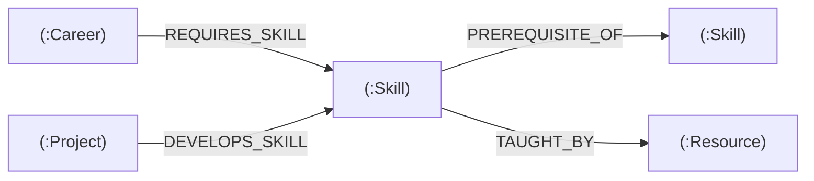

# 🧭 SkillGraph AI — Personalized Career Navigator

> **Neo4j × hackFront India Graph Builder Build Sprint**  
> *Transforming static career checklists into a dynamic, prerequisite-aware knowledge graph.*

[](https://streamlit.io)
[](https://neo4j.com)
[](https://python.org)
[](https://opensource.org/licenses/MIT)

---

## 1. What SkillGraph AI Does

Traditional career and job platforms treat skills as isolated checklists. They tell you *what* skills you need, but cannot tell you:
- What foundational concepts block you from learning advanced ones.
- In what strict sequence you should learn to avoid tutorial purgatory.
- Which real-world capstone projects will simultaneously bridge multiple missing competencies.

**SkillGraph AI** models careers, skills, prerequisites, courses, and portfolio capstones as a first-class property graph in **Neo4j**. By traversing relationships with Cypher queries and Kahn's topological sorting algorithm, SkillGraph AI computes:
1. **Precise Skill-Gap Coverage**: Exact mathematical readiness percentage against industry benchmarks.
2. **Prerequisite-Aware Blocking Analysis**: Clearly distinguishes skills you are *Ready to Learn Now* vs. skills *Blocked by Unmet Prerequisites*.
3. **Four-Stage Personalized Learning Roadmap**: Foundations → Core Competencies → Advanced Specialization → Portfolio Capstones.
4. **Targeted Project Recommendations**: Projects dynamically matched to the exact skills you're missing.
5. **Interactive Knowledge Graph Visualization**: Explore nodes and relationships in a responsive force-directed graph.
6. **Graceful Demo Mode**: Immediate zero-config exploration with full dataset fidelity even without live database credentials.

---

## 2. Neo4j Graph Model

### Node Types
- `(:Career {id, name, description, category, avg_salary_range})`
- `(:Skill {id, name, category, difficulty, estimated_hours, description})`
- `(:Project {id, name, difficulty, estimated_hours, description, github_template})`
- `(:Resource {id, name, url, type, platform, duration_hours})`

### Relationship Types


- `(c:Career)-[:REQUIRES_SKILL {importance: 'Core'|'Specialized'|'Foundational'}]->(s:Skill)`
- `(prerequisite:Skill)-[:PREREQUISITE_OF]->(advancedSkill:Skill)`
- `(project:Project)-[:DEVELOPS_SKILL]->(s:Skill)`
- `(s:Skill)-[:TAUGHT_BY]->(r:Resource)`

### Target Careers Modeled
- **AI Engineer**
- **Data Scientist**
- **Software Developer**
- **Cybersecurity Analyst**
- **Data Analyst**

---

## 3. Authentication & User Data Isolation

SkillGraph AI features a production-ready authentication gateway. All dashboard pages, career exploration graphs, and AI coaching tools require authentication before access.

### Dual-Mode Authentication Architecture
1. **Supabase Cloud Authentication (Recommended)**:
   - Integrates with Supabase Auth using the official Python client.
   - Configure `SUPABASE_URL` and `SUPABASE_KEY` (Anon Public Key) in `.streamlit/secrets.toml` or environment variables.
   - Passwords and credentials are managed in Supabase Cloud.

2. **Secure Local Bcrypt-Salted Auth Store (Active by Default)**:
   - When Supabase credentials are not provided, SkillGraph AI operates seamlessly with a local cryptographic auth database (`data/user_auth.db`).
   - Uses `bcrypt` with cryptographic salt generation. Passwords are never stored in plaintext.
   - Validates email formats, enforces password length ($\ge 6$ chars), and prevents duplicate email registration.

### User Data Isolation
Each authenticated user has an isolated profile and progress records:
- Selected target career pathway
- Mastered and acquired competencies
- Active in-progress skills
- Weekly study pacing & estimated timeline
- Completed capstone projects

User data is keyed strictly to the authenticated user's stable unique ID, ensuring one user's private roadmap is never accessible to another user.

---

## 4. How to Create Your First Account
1. Launch the app (`streamlit run app.py`).
2. On the gateway page, click **Create an Account**.
3. Enter your **Full Name**, **Email Address**, and a secure **Password** ($\ge 6$ characters).
4. Click **Create Account**. Your session is immediately established and you are redirected to the personalized dashboard!
5. To log out, click **🚪 Sign Out** in the sidebar navigation or in **Settings**.


## 3. How to Run Locally

### Prerequisites
- Python 3.10+ installed
- Git installed

### Step 1: Clone the Repository
```bash
git clone https://github.com/your-username/SkillGraphAI.git
cd SkillGraphAI
```

### Step 2: Create a Virtual Environment (Optional but Recommended)
```bash
python3 -m venv venv
source venv/bin/activate  # On Windows: venv\Scripts\activate
```

### Step 3: Install Dependencies
```bash
pip install -r requirements.txt
```

### Step 4: Run the Streamlit Application
```bash
streamlit run app.py
```
Open [http://localhost:8501](http://localhost:8501) in your browser. The app runs immediately in **Demo Mode** out of the box!

---

## 4. How to Create & Configure a Neo4j Aura Database

1. Navigate to [Neo4j Aura Console](https://console.neo4j.io/) and sign in with Google or email.
2. Click **New Instance** and choose the **AuraDB Free** tier.
3. Name your instance (e.g., `skillgraph-aura`).
4. **IMPORTANT**: Download or save the generated credentials (`NEO4J_URI`, `NEO4J_USERNAME`, `NEO4J_PASSWORD`). The password is only shown once!
5. Wait ~2 minutes until your instance status shows **Running**.

---

## 5. How to Run `database/seed.cypher` in Neo4j

The seed script uses idempotent `MERGE` commands and unique constraints so it can safely be executed multiple times without duplication.

1. In the Neo4j Aura console, click **Open** > **Neo4j Workspace / Browser**.
2. Authenticate using your username (`neo4j`) and generated password.
3. Open the file [`database/seed.cypher`](database/seed.cypher) in this repository.
4. Copy the entire contents and paste it into the Cypher editor in Neo4j Browser.
5. Click **Run** (or press `Ctrl+Enter` / `Cmd+Enter`).
6. Verify your graph by running:
   ```cypher
   MATCH (n) RETURN labels(n)[0] AS NodeType, count(n) AS Count;
   ```
   You should see Careers, Skills, Projects, and Resources populated with all relationships.

---

## 6. How to Configure Streamlit Secrets

### Local Development
1. Copy the example secrets file:
   ```bash
   cp .streamlit/secrets.toml.example .streamlit/secrets.toml
   ```
2. Open `.streamlit/secrets.toml` and fill in your Neo4j credentials:
   ```toml
   NEO4J_URI = "neo4j+s://your-instance-id.databases.neo4j.io"
   NEO4J_USERNAME = "neo4j"
   NEO4J_PASSWORD = "your-actual-password"
   ```
3. Restart `streamlit run app.py`. The sidebar status will switch to `🟢 Live Neo4j Aura Connected`.

*(Note: `.streamlit/secrets.toml` is included in `.gitignore` and is never committed.)*

---

## 7. How to Push the Project to GitHub

```bash
git init
git add .
git commit -m "feat: complete SkillGraph AI career navigator with Neo4j integration"
git branch -M main
git remote add origin https://github.com/your-username/SkillGraphAI.git
git push -u origin main
```

---

## 8. How to Deploy on Streamlit Community Cloud

1. Go to [share.streamlit.io](https://share.streamlit.io/) and log in with your GitHub account.
2. Click **New app**.
3. Select your repository: `your-username/SkillGraphAI`.
4. Branch: `main`.
5. Main file path: `app.py`.
6. Click **Advanced settings...** before deploying (or see step 9).
7. Click **Deploy!**

---

## 9. How to Configure the Deployed App's Secrets

1. On your Streamlit Community Cloud dashboard, click the three dots (`⋮`) next to your app and choose **Settings**.
2. Select the **Secrets** tab on the left menu.
3. Paste your Neo4j Aura credentials:
   ```toml
   NEO4J_URI = "neo4j+s://your-instance-id.databases.neo4j.io"
   NEO4J_USERNAME = "neo4j"
   NEO4J_PASSWORD = "your-actual-password"
   ```
4. Click **Save**. Streamlit Community Cloud will automatically reload the app with live database connectivity.

---

## 10. How to Test the Live App

1. **Verify Connection**: Look at the sidebar status badge. It should show `🟢 Live Neo4j Aura Connected` with your URI.
2. **Test Career Selection**: Switch between **AI Engineer**, **Data Scientist**, **Software Developer**, **Cybersecurity Analyst**, and **Data Analyst**. Observe instantaneous metric updates.
3. **Test Skill Selection**: Select or deselect skills like `Python`, `SQL`, `Statistics`. Check that:
   - Coverage percentage updates in the KPI card and donut chart.
   - Mastered vs. Ready to Learn vs. Blocked skills dynamically re-sort.
4. **Test Prerequisite Ordering**: If `Machine Learning` is missing and `Python` is not yet completed, `Machine Learning` is flagged as blocked by `Python`. Once you select `Python`, `Machine Learning` moves to **Ready to Learn**.
5. **Explore the Graph**: In the Interactive Graph section, drag nodes, zoom in, and hover over nodes to view property cards.
6. **Inspect Cypher**: Expand the "Hackathon Judges: View Live Cypher Queries" accordion to see real Cypher traversal patterns.

---

## Project Structure

```
SkillGraphAI/
├── app.py                      # Main Streamlit dashboard coordinator
├── requirements.txt            # Minimal compatible Python dependencies
├── README.md                   # Comprehensive documentation & deployment guide
├── .gitignore                  # Protects credentials, virtualenvs & cache
│
├── .streamlit/
│   ├── config.toml             # WhereUElevate SaaS theme tokens
│   └── secrets.toml.example    # Credential template for Aura deployment
│
├── database/
│   └── seed.cypher             # Idempotent MERGE script for graph population
│
├── components/                 # Presentation layer (UI Rendering)
│   ├── __init__.py
│   ├── header.py               # Top dashboard navbar & user pill
│   ├── sidebar.py              # Left navigation sidebar & credential modal
│   ├── metrics.py              # Hero banner card & 4 white KPI cards
│   ├── skill_gap.py            # Donut chart & Mastered/Ready/Blocked badges
│   ├── learning_roadmap.py     # Connected vertical roadmap timeline
│   ├── project_cards.py        # Capstone project recommendations
│   ├── career_exploration.py   # 5-career trajectory exploration cards
│   ├── career_graph.py         # Vis.js interactive network container
│   └── diagnostics.py          # System Health & Validation diagnostic suite
│
├── services/                   # Business & Data Access layer
│   ├── __init__.py
│   ├── neo4j_service.py        # Single driver lifecycle, health checks & queries
│   ├── career_service.py       # Career catalog & required skills mapping
│   ├── skill_service.py        # Skill nodes & prerequisite graph traversal
│   ├── roadmap_service.py      # Kahn's topological sort & blocker mapping
│   ├── project_service.py      # Project ranking & learning resource matching
│   └── demo_data.py            # Canonical graph dataset for demo & testing
│
├── utils/                      # Pure helper utilities
│   ├── __init__.py
│   ├── calculations.py         # Coverage % and timeline mathematical calculations
│   ├── validators.py           # Schema, credential, and input validation
│   └── error_handlers.py       # Sanitized error reporting (never exposing secrets)
│
└── tests/                      # Automated test suite (pytest)
    ├── __init__.py
    ├── test_calculations.py    # 19 mathematical & normalization unit tests
    ├── test_skill_gap.py       # 4 deterministic skill gap analysis tests
    ├── test_roadmap.py         # 5 topological sort & cycle detection tests
    ├── test_projects.py        # 4 project ranking & resource retrieval tests
    ├── test_neo4j.py           # 6 connection, credentials & health check tests
    └── test_app_smoke.py       # 3 application smoke & visualizer tests
```

---

## Running Automated Tests

Run the full automated test suite using `pytest`:
```bash
pytest tests/ -v
```

To run with live Neo4j Aura integration tests enabled (requires valid credentials in environment):
```bash
RUN_LIVE_NEO4J_TESTS=1 pytest tests/ -v
```

---

## License

Distributed under the MIT License. Built for the **Neo4j × hackFront India Graph Builder Build Sprint**.

